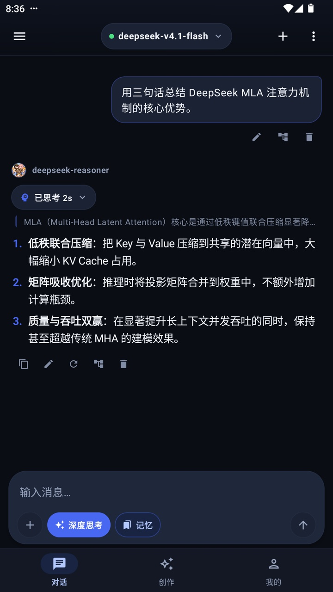
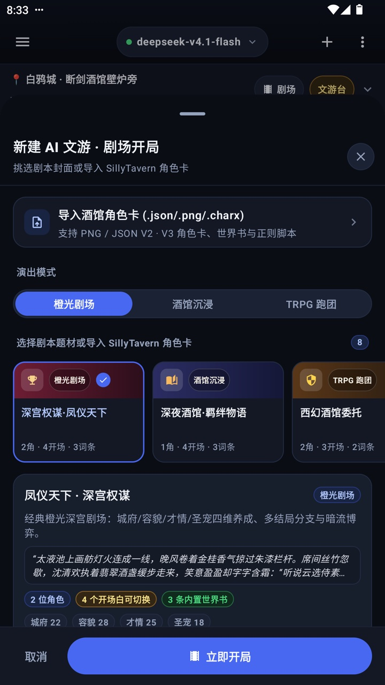
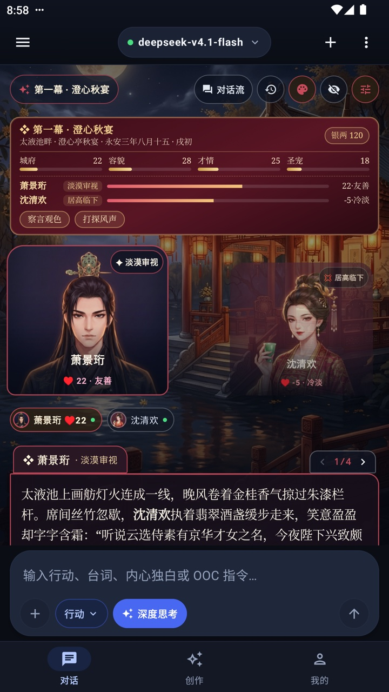
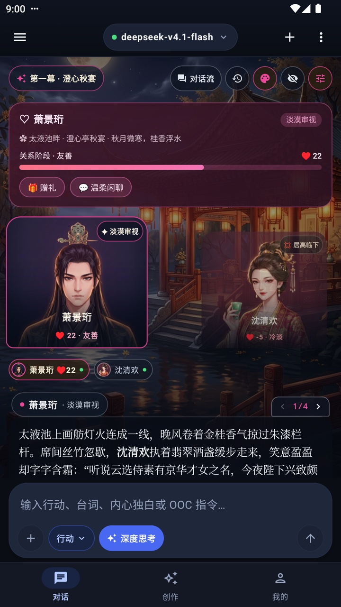
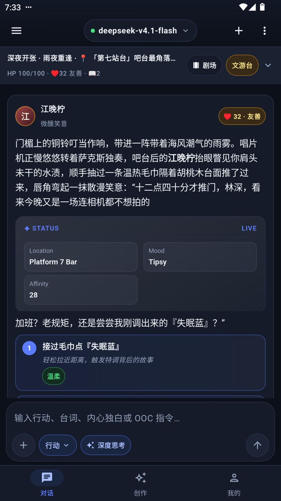
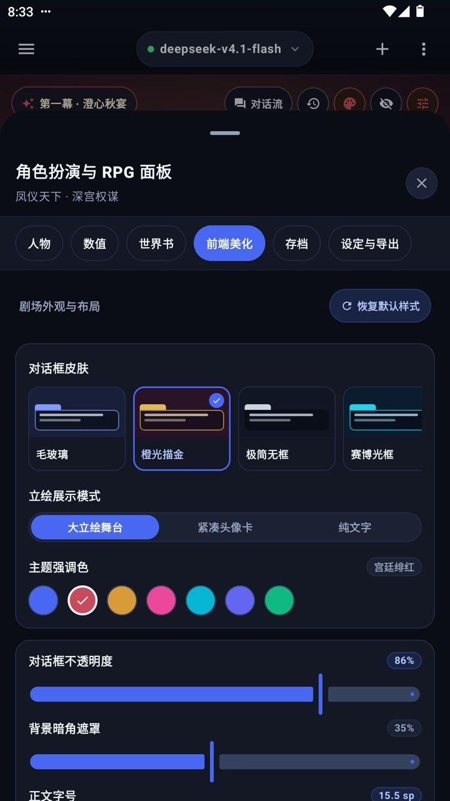
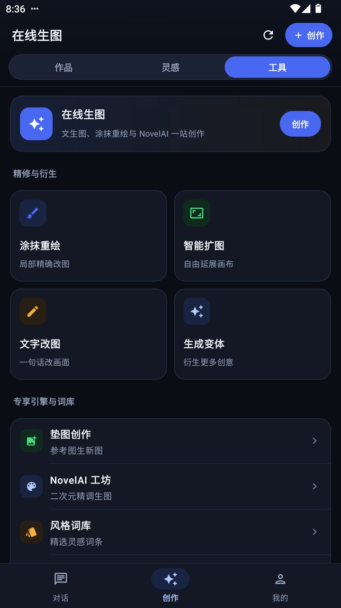
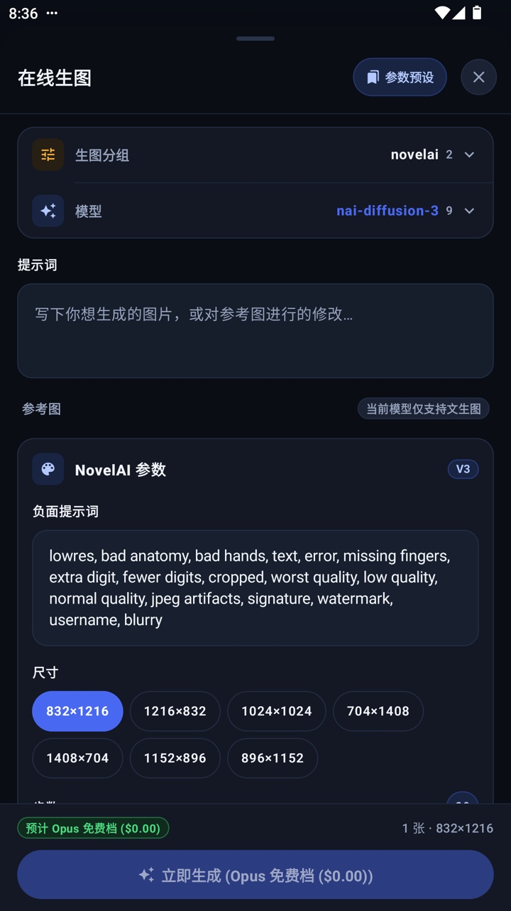
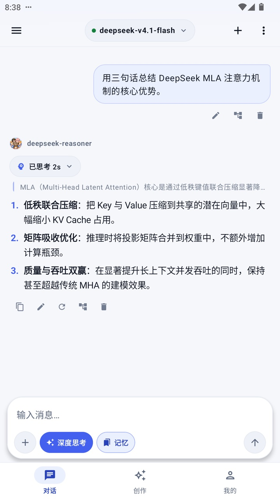

# GuGuChat（咕咕嘎 AI 客户端）

**GuGuChat**（`com.gugachat.app`）是一款基于 **Kotlin + Jetpack Compose** 开发的原生 Android AI 客户端，集 **多协议 AI 对话、互动文游（RP）、长篇小说创作工坊、多平台历史导入、在线生图与精修** 于一体。

支持 **咕咕嘎（sub2api-auto）账号登录**，也支持 **完全脱离后端的自定义 API 直连模式**（兼容 4 大主流 AI 协议），所有本地会话、记忆与密钥均安全保存在本机。

---

## 界面预览

<table>
  <tr>
    <td align="center" width="33%">
      <br />
      <sub><b>极简对话流 · R1 深度思考链</b></sub>
    </td>
    <td align="center" width="33%">
      <br />
      <sub><b>酒馆封面卡大厅 · 多开场预览</b></sub>
    </td>
    <td align="center" width="33%">
      <br />
      <sub><b>橙光双人立绘剧场 · HTML 状态栏</b></sub>
    </td>
  </tr>
  <tr>
    <td align="center" width="33%">
      <br />
      <sub><b>前端美化 · 恋爱手账 & 极简无框</b></sub>
    </td>
    <td align="center" width="33%">
      <br />
      <sub><b>酒馆正则 · 内嵌 HTML 状态卡</b></sub>
    </td>
    <td align="center" width="33%">
      <br />
      <sub><b>文游台 · 5 套皮肤可视化编辑</b></sub>
    </td>
  </tr>
  <tr>
    <td align="center" width="33%">
      <br />
      <sub><b>创作工坊 · 工具台与工作流</b></sub>
    </td>
    <td align="center" width="33%">
      <br />
      <sub><b>在线生图 · NovelAI 工坊</b></sub>
    </td>
    <td align="center" width="33%">
      <br />
      <sub><b>浅色瓷白主题自适应</b></sub>
    </td>
  </tr>
</table>

---

## 核心特性

### 1. 四大标准 AI API 协议与混合接入
- **OpenAI Chat Completions**（`/v1/chat/completions`、`/v1/models`、`/v1/images/generations`、`/v1/images/edits`）
- **OpenAI Responses**（`/v1/responses`，支持推理摘要与用量流式事件）
- **Anthropic Claude Messages**（`/v1/messages`，支持 Extended Thinking 思考块与多模态识图）
- **Google Gemini Native**（`/v1beta/models/*:streamGenerateContent?alt=sse`、Imagen 与原生生图）
- **双接入模式**：支持咕咕嘎服务端账号登录（含 2FA、内嵌人机验证与 WebView 登录）或直接在登录页进入「自定义 API 直连」，也可在 **我的 → 自定义 API 通道** 中管理多个自定义接口并与服务端分组自由混用；API Key 使用 `EncryptedSharedPreferences` 本地加密存储。

### 2. DeepSeek 极简对话 × 酒馆 × 橙光三合一创作空间
- **极简流式对话与上下文治理**：无框呼吸感阅读画布、左侧细轨 R1 可折叠深度思考链、悬浮胶囊输入框、时间分组会话抽屉（置顶 / 今天 / 昨天 / 近7天 / 更早）、可视化分段上下文水位条、自动压缩与中文 BM25 长期记忆召回。
- **酒馆（SillyTavern）核心玩法**：
  - 完整打通 **RP 世界书（Lorebook）** 常驻注入与关键词/实体动态召回；
  - 支持 **多开场白（Alternate Greetings）** 左右滑切 `< 1/N >`、`{{char}}`/`{{user}}`/`{{scene}}` 宏替换、导演便签（Author's Note）与后置指令（Post-History）；
  - 支持 **AI 回复在线编辑、原地续写（Continue）、AI 代写（Impersonate）**、流式内部标签自动防泄漏，以及 **SillyTavern V1/V2/V3 `.png` / `.json` 角色卡导入与带立绘 PNG 导出**；
  - 内置 **酒馆正则美化引擎（兼容 `extensions.regex_scripts`）** 与 **离线 WebView HTML/CSS 沙箱渲染器**，支持消息内嵌 HTML 状态卡、自定义顶部前端状态栏模板（深宫凤仪 / 酒馆玻璃态 / 赛博终端 / 恋爱手账）及 `window.GuGuRp` 卡片按钮双向交互。
- **橙光（AVG 互动剧场）核心玩法**：
  - 支持一键切换 **橙光大立绘剧场 ↔ 对话流**，提供多角色同屏站位（主讲放大高亮 / 配角微暗）、**8 表情差分立绘**（按心情自动切换）与 **一键联动内置生图 API 生成角色立绘 / 表情差分 / 场景 CG**；
  - 内置 **前端外观可视化编辑器**（5 套对话框皮肤：毛玻璃 / 橙光描金 / 极简无框 / 赛博光框 / 古风宣纸，实时调节透明度、背景遮罩、字号、强调色与立绘高度）、事件与场景 **CG 图鉴**、条件锁分支选项、好感 7 阶称号、回合数值播报、多结局图鉴及多档位 S/L 回溯与开新分支；
  - 内置 8 套旗舰剧本预设（含《凤仪天下 · 深宫权谋》《第七站台 · 深夜清吧》等）及 d20 / CoC d100 跑团检定。
- **长篇小说工坊**：题材封面卡开书向导、分章管理、独立世界书、三路剧情草稿、大纲共创、润色工具、护眼多纸张**纯净阅读模式**以及 `.txt` / `.md` 一键导出。

### 3. 多平台外部对话 / 剧本一键导入
支持从主流 AI 与文字互动平台迁移历史记录，自动识别格式并支持预览筛选与目标模式切换（对话 / 文游 / 小说）：
- **DeepSeek**：支持「导入官方 `.zip` / `conversations.json`」与「粘贴下载链接直接解析」，保留思考链与多分支回复。
- **酒馆（SillyTavern）**：支持 V1/V2/V3 角色卡（`.png` / `.json`，含 `character_book` 世界书与 `regex_scripts` 正则脚本）、独立世界书 `.json`、聊天记录 `.jsonl`（保留多分支 `swipes` 与思考链）及打包 `.zip`。
- **橙光 / 互动剧本**：支持导入 `.txt` / `.md` / `.json` 剧本文件或直接粘贴剧本文本，自动提取章节、角色台词与分支选项，直接以文游或小说续写。
- **Chatbox / ChatGPT / Claude / Markdown**：支持 Chatbox JSON 备份、ChatGPT 与 Claude 官方导出包及常见 Markdown 对话记录。

### 4. 统一创作工坊（作品 · 灵感 · 工具）
- **作品画廊**：统一展示服务端与直连 API 本地保存的作品，支持搜索、筛选、批量管理、详情查看、双指缩放多图灯箱、保存到相册与系统分享。
- **灵感与风格词库**：瀑布流精选提示词与风格词条，一键复制或携带比例直接「画同款」。
- **多引擎生图与精修**：支持分组/模型快速折叠选择、参数预设库、参考图垫图、**NovelAI V3 / V4.5 / V5** 参数精调，以及 **涂抹重绘（Inpaint）、智能扩图（Outpaint）、文字改图、生成变体** 四合一画布编辑器。

### 5. 双视觉风格、自动检测更新与数据备份
- 提供 **咕咕嘎** 与 **极简** 两套视觉风格，支持 **跟随系统 / 浅色 / 深色** 主题以及 **简体中文 / English** 实时切换。
- **自动检测更新**：启动时静默检查 GitHub Releases 最新版本，支持一键应用内下载安装、跳转发布页或稍后更新。
- 支持完整的本地 JSON 备份导出与恢复。

---

## 下载安装

前往本仓库的 [**Releases 页面**](https://github.com/Espboxx/gugachat/releases) 下载最新版本的 `.apk` 安装包（要求 **Android 8.0 / API 26** 及以上）。

---

## 本地构建指南

### 环境要求
- **JDK**：JDK 17
- **Android SDK**：`compileSdk = 34`，`targetSdk = 34`，`minSdk = 26`
- **Gradle**：内置 Wrapper `8.14.3`（已配置国内镜像加速）

### 运行单元测试

```bash
./gradlew :app:testDebugUnitTest --no-daemon --console=plain
```

### 构建 APK

```bash
# 构建 Debug APK -> app/build/outputs/apk/debug/app-debug.apk
./gradlew :app:assembleDebug --no-daemon --console=plain

# 构建 Release APK -> app/build/outputs/apk/release/app-release.apk
./gradlew :app:assembleRelease --no-daemon --console=plain
```

---

## 交流与反馈

欢迎提交 Issue 或 Pull Request，一起完善 GuGuChat！

- **QQ 交流群**：`587660465`
